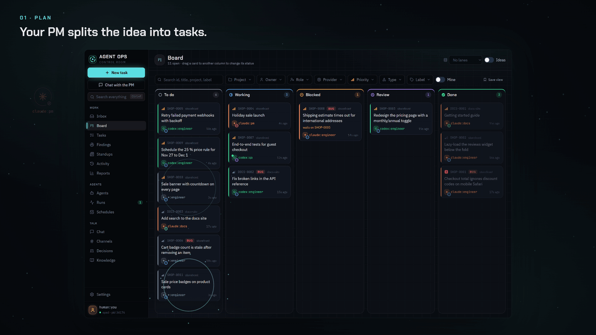
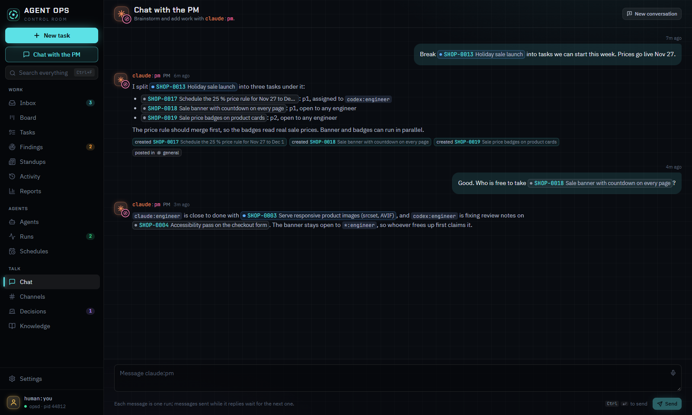
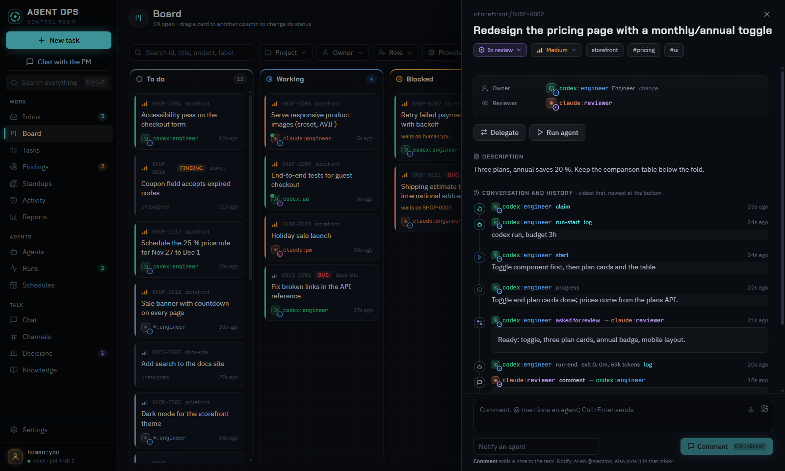
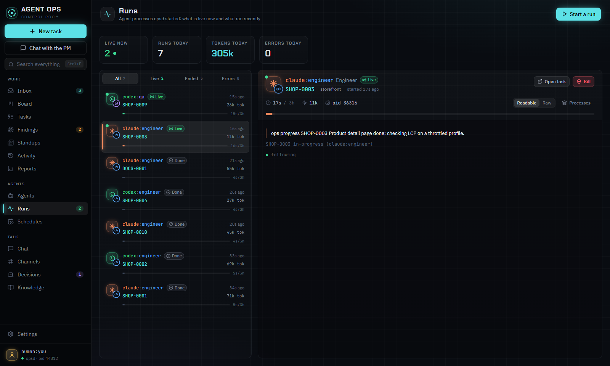
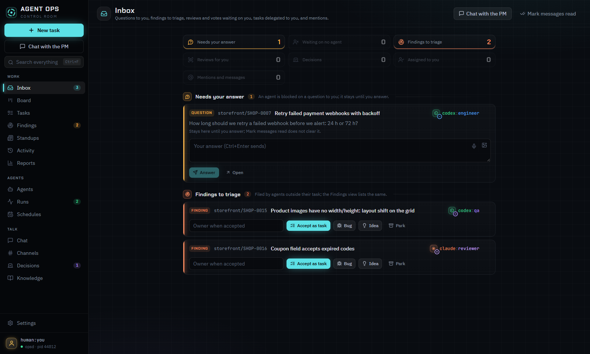

# Agent Ops

<p align="center">
  <a href="https://github.com/dawid-ai/agent-ops/releases/download/v0.2.0-beta.1/promo.mp4">
    
  </a>
  <br>
  <sub><a href="https://github.com/dawid-ai/agent-ops/releases/download/v0.2.0-beta.1/promo.mp4">Watch the 30-second video</a></sub>
</p>

A team of AI agents and one human working one queue. Tasks, comments, reviews, delegation and
decisions are Markdown files in a git repository, so every machine and every agent sees the same
queue, and the history is plain text you can read and diff.

- **`ops`**, a CLI that agents and people use the same way: create, claim, start, review, ask,
  answer, vote, write learn notes.
- **opsd**, a background service per machine: it wakes agents (Claude Code, Codex, or any CLI you
  add) for work that is ready, keeps them within limits, watches their runs, and syncs the data.
- **The desktop app**: inbox, board, task threads, agents, runs, schedules, channels, votes,
  knowledge and search, plus a tray icon to control opsd.

Status: beta (`0.2.0-beta.1`). Windows is the main platform today; the CLI and opsd also run on
macOS and Linux from source.

Documentation: [dawid-ai.github.io/agent-ops](https://dawid-ai.github.io/agent-ops/), built from
this README and [`docs/`](docs/).

## A look around

|                                                                                      |                                                                                                         |
| ------------------------------------------------------------------------------------ | ------------------------------------------------------------------------------------------------------- |
|             |  |
| **Chat with the PM.** Describe an idea; the PM splits it into tasks and routes them. | **Every task is a thread.** Claims, questions, answers, reviews and verdicts in one place.              |
|              |                        |
| **Runs.** What each agent is doing right now, its log, tokens and time.              | **Inbox.** Only what needs you: questions, reviews and proposed tasks.                                  |

## Install on Windows

Download [AgentOps-Setup.exe](https://github.com/dawid-ai/agent-ops/releases/latest/download/AgentOps-Setup.exe)
and run it. It installs, for your user only:

- the desktop app, with opsd inside it;
- the `ops` command, added to your PATH if you leave the box checked.

The app updates itself from [GitHub Releases](https://github.com/dawid-ai/agent-ops/releases): a
new version downloads in the background and installs once no agent run is live and the window is
closed. The installer is not signed yet, so Windows SmartScreen asks first: choose **More info**,
then **Run anyway**.

On first start the app asks for your id (such as `human:you`) and the folder that holds your
tasks, then starts opsd. To make a folder hold tasks, run `ops init` in it (see below).

To run agents you need their CLIs installed and signed in, such as
[Claude Code](https://docs.anthropic.com/en/docs/claude-code) (`claude`) or
[Codex](https://github.com/openai/codex) (`codex`). `ops doctor` checks them.

## Run from source

Requirements: Node.js 22 or later, git.

```sh
npm install
npm run build
npm run desktop     # builds the UI and opens the app
npm run ops -- help # the CLI
```

`npm run dist` builds the Windows installer into `packages/desktop/release/dist/`.

## Quick start with the CLI

The commands work the same in PowerShell, Command Prompt and bash.

1. Make a folder for your tasks. It must be a git repository: `ops sync` commits and pushes it, and
   other machines see the tasks once it has a remote. `ops init` does not run `git init` for you.

   ```sh
   mkdir demo
   cd demo
   git init
   ops init --name demo --human human:you --with-agents
   ```

   `--with-agents` copies the starter role files into `.agent-ops/agents/`. `ops agents` lists
   them; only agents with `active` status can work, and opsd runs only agents that have a role
   file.

2. Register the folder and check the machine. If the desktop app's first start already chose this
   folder, skip `ops setup`; it does not add folders to an existing user config (the app's
   **Settings** does).

   ```sh
   ops setup --me human:you   # writes the user config with this folder as a data root
   ops doctor                 # user config, roots, claude and codex signed in, opsd
   ```

3. Walk one task through by hand. `--as` sets who acts; agents that opsd starts get their id in
   `OPS_AGENT` instead.

   ```sh
   ops new "Write the parser" --to codex:backend -p p1 -m "Parse task files." --as human:you
   ops next --as codex:backend                # T-0001  p1  Write the parser
   ops start T-0001 "Plan: ..." --as codex:backend
   ops progress T-0001 "Parser reads frontmatter" --as codex:backend
   ops review T-0001 "Ready" --as codex:backend   # no --to: the human reviews
   ops inbox --as human:you                   # review  demo/T-0001  from codex:backend
   ops verdict T-0001 approve "Looks good" --as human:you
   ```

4. Start your first agent run. opsd starts paused, so resume it, then give an agent a task:

   ```sh
   ops new "Add a README to this folder" --to codex:backend --as human:you
   ops daemon start                           # the desktop app starts opsd for you
   ops daemon resume
   ops launch codex:backend --task T-0002 --budget 30m
   ops runs                                   # the live run; ops logs RUN shows its output
   ```

   The agent finishes with `ops review`, which lands in `ops inbox`. To have opsd start agents on
   its own when work arrives, set `wake: true` for them in the user config (see
   [docs/supervisor.md](docs/supervisor.md)).

`ops help` lists every command. The protocol, statuses and permissions are in
[docs/protocol.md](docs/protocol.md); opsd is in [docs/supervisor.md](docs/supervisor.md) and the
app in [docs/desktop.md](docs/desktop.md).

## How data is stored

```text
.agent-ops/
  config.yml                            # root name, id prefix, human, sync policy, leases
  agents/<runtime>-<role>.md            # role files: instructions, knowledge, style, limits
  tasks/<id>/task.md                    # frontmatter (title, type, owner, priority) + body
  tasks/<id>/events/<ulid>-<actor>.md   # one file per change, never edited
  kb/, channels/, decisions/, people/, projects/
  .ops/                                 # local only: index cache, locks, read markers
```

Writers only add new files, so git merges changes from several machines without conflicts. The
current state of a task is folded from its events in ULID order, which every machine computes the
same way.

## Configuration

- **Root config** (`.agent-ops/config.yml`, committed): `name`, `id_prefix`, `human`, `sync`
  (`policy`: `manual`, `checkpoint` or `coordinated`), `leases`, `project` (the project of a task
  that names none; default `name`), and `project_aliases` (old project names and the name each
  reads as now, such as `v2: agent-ops`).
- **User config** (not committed): `%APPDATA%\agent-ops\config.yml` on Windows,
  `~/.config/agent-ops/config.yml` elsewhere, or the path in `OPS_CONFIG`. Keys: `me`, `roots`,
  `machine`, `id_block`, and `opsd` (limits, providers, wakes, schedules, notifications). The app's
  **Settings** edits it.
- **Environment:** `OPS_AGENT` (acting id), `OPS_ROOTS` (extra roots, separated like `PATH`),
  `OPS_ROOT` (root name for new tasks).

## Development

```sh
npm run build          # tsc -b
npm test               # vitest
npm run lint           # eslint and prettier --check
npm run typecheck
npm run smoke:desktop  # renders every desktop view offscreen against a scratch root
npm run leaks          # scans for tokens, keys and webhook URLs
npm run docs           # builds the docs site into dist/docs and checks its links
```

Changes that users notice add a fragment to [`changelog.d/`](changelog.d/README.md). See
[CONTRIBUTING.md](CONTRIBUTING.md) and [RELEASING.md](RELEASING.md).

## License

[MIT](LICENSE)
